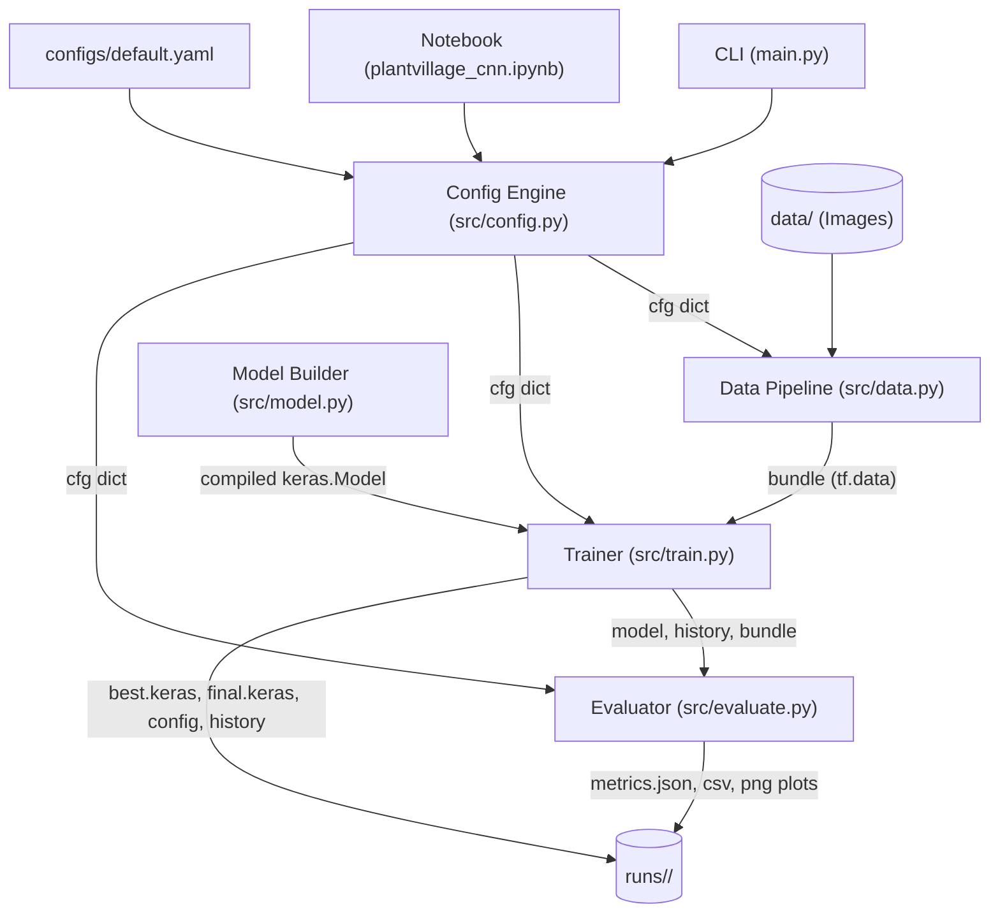
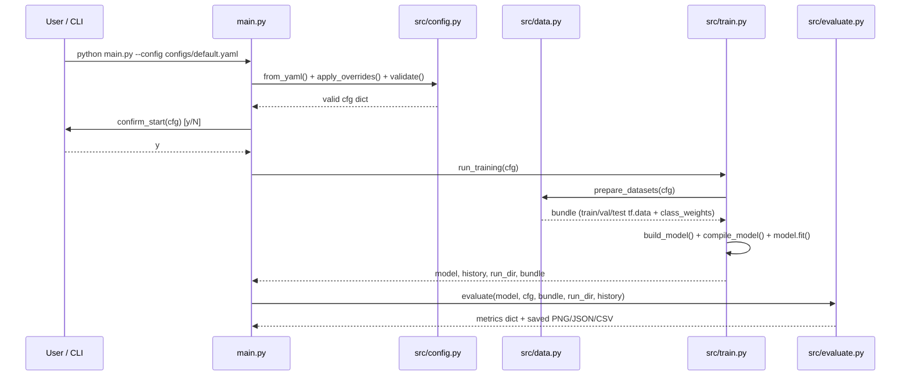

# CODEBASE GUIDE

### 1. Ringkasan Sistem
PlantVile adalah proyek klasifikasi citra penyakit daun tanaman berbasis Convolutional Neural Network (CNN) menggunakan dataset PlantVillage (`README.md:1-11`). Sistem ini ditujukan untuk kebutuhan akademik (UAS Neuro Computing, PENS) serta eksperimen klasifikasi citra supervised learning (`README.md:1,10`, `scripts/build_notebook.py:26-32`). Input utama berupa direktori citra daun RGB/grayscale berlabel folder kelas (baik struktur flat `<root>/<Class>/` maupun bertingkat `<root>/{color,grayscale,segmented}/<Class>/`), dan output berupa model terlatih (`.keras`), log riwayat epoch (`history.csv`, `history.json`), snapshot konfigurasi, metrik evaluasi (`test_metrics.json`, `test_per_class.csv`), serta plot visual (`test_confusion_matrix.png`, `test_loss_accuracy.png`, `test_sample_predictions.png`) di dalam folder `runs/<run_name>/` (`README.md:40-44,83-98`, `src/data.py:14-38`). Mekanisme intinya digerakkan oleh satu skema konfigurasi deklaratif (`SPEC`) di `src/config.py:10-126` yang mengatur pipeline `tf.data`, arsitektur CNN (`simple_cnn` atau transfer learning ImageNet), training loop Keras, dan evaluasi `scikit-learn`. Berdasarkan inspeksi kode, proyek ini berstatus prototipe/alat eksperimen terstruktur yang siap pakai (`Implemented, not execution-verified` di environment lokal saat ini karena `data/` dan `runs/` belum tersedia di workspace).

---

### 2. Tujuan, Pengguna, dan Batas Sistem
- **Domain Masalah:** Klasifikasi penyakit daun tanaman multi-kelas (mendukung 15 kelas terpasang atau 38 kelas PlantVillage penuh, dengan ketidakseimbangan kelas hingga 21x pada dataset yang didokumentasikan) (`README.md:6,46-48`, `configs/default.yaml:7,12`).
- **Pengguna Utama:** Mahasiswa/peneliti yang menjalankan eksperimen via CLI (`main.py`) atau antarmuka interaktif Jupyter Notebook (`notebook/plantvillage_cnn.ipynb`) (`main.py:4-12`, `README.md:168-179`).
- **Kapabilitas Nyata (Terimplementasi):**
  - Manajemen ~86 parameter terpusat via YAML, CLI `--set`, atau interactive wizard (`src/config.py:10-126,186-213,305-338`).
  - Mode validasi pra-training (`--check`) dan evaluasi ulang model tersimpan (`--eval`) (`main.py:62-112`).
  - Pipeline `tf.data` dengan stratified/tail split per kelas, caching (memory/disk), augmentasi on-the-fly, normalisasi per-backbone, dan `class_weight` (`src/data.py:79-260`).
  - 5 pilihan arsitektur (`simple_cnn`, `vgg16`, `mobilenetv2`, `resnet50`, `efficientnetb0`), 5 optimizer, 3 loss function (termasuk custom `focal_loss`), dan callbacks Keras (`src/model.py:12-156`, `src/train.py:11-58`).
- **Batas Sistem & Eksklusi:**
  - Tidak ada REST API, web server, atau antarmuka deployment produksi.
  - Tidak ada mekanisme pengunduhan dataset otomatis dari Kaggle (dataset harus disiapkan manual di `data/`, atau menggunakan generator dummy `scripts/make_dummy_dataset.py`).
  - Tidak ada suite unit test otomatis (`pytest`/`unittest`) di repository.

---

### 3. Tech Stack

| Teknologi / Dependensi | Peran / Tujuan | Lokasi Penggunaan | Status | Bukti File:Line |
| :--- | :--- | :--- | :--- | :--- |
| **Python 3** | Bahasa pemrograman utama seluruh pipeline CLI, modul `src/`, dan skrip utilitas | Seluruh codebase | ACTIVE | `main.py:1`, `src/*.py` |
| **TensorFlow (`2.21.0`)** | Backend tensor, pipeline `tf.data` (I/O file, decode citra, resize, shuffle, cache, batch, prefetch), seed & deteksi/konfigurasi GPU/CPU | Data pipeline, seeding, device setup, notebook | ACTIVE | `requirements.txt:5`, `src/data.py:7,10,123-127,205-233`, `src/utils.py:16-60` |
| **Keras (`3.15.1`)** | Membangun arsitektur CNN (`simple_cnn` & transfer learning ImageNet), layer augmentasi (`Sequential`), optimizer, loss, callbacks, load/save `.keras` | Data augmentation, model builder, training loop, evaluasi & inferensi | ACTIVE | `requirements.txt:6`, `src/data.py:146,163`, `src/model.py:2,4,41,106-153`, `src/train.py:4,17-56`, `src/evaluate.py:4,95-108` |
| **NumPy (`>=2.0`)** | Manipulasi array numerik, perhitungan jumlah parameter, seeding, agregasi prediksi, pembuatan piksel dummy | Data, model, evaluasi, utils, dummy generator | ACTIVE | `requirements.txt:7`, `src/data.py:6,322`, `src/model.py:3,94-95`, `src/evaluate.py:5,17-22,90-115`, `scripts/make_dummy_dataset.py:8,23,29` |
| **PyYAML (`>=6.0`)** | Parsing file konfigurasi `configs/default.yaml` dan menyimpan snapshot `config_used.yaml` | Config loader & training artifact exporter | ACTIVE | `requirements.txt:13`, `src/config.py:6,192`, `src/train.py:121-123` |
| **Scikit-learn (`>=1.5`)** | Menghitung metrik evaluasi (`accuracy`, `precision`, `recall`, `f1_score`), `confusion_matrix`, dan `classification_report` | Tahap evaluasi model | ACTIVE | `requirements.txt:11`, `src/evaluate.py:36-38,130-132,156-183` |
| **Matplotlib (`>=3.8`)** | Backend headless (`Agg`) untuk merender dan menyimpan kurva loss/accuracy, confusion matrix, dan grid sampel prediksi | Tahap evaluasi & EDA/visualisasi di notebook | ACTIVE | `requirements.txt:9`, `src/evaluate.py:27-29,39-76,85-124`, `scripts/build_notebook.py:86,98-100` |
| **Seaborn (`>=0.13`)** | Merender heatmap confusion matrix dengan anotasi | Tahap evaluasi (plotting) | ACTIVE | `requirements.txt:10`, `src/evaluate.py:30,41` |
| **Pillow (`>=10.0`)** | Membuat dan menyimpan gambar JPEG dummy; memuat gambar untuk inspeksi EDA & inferensi di notebook | Skrip dummy dataset & notebook | ACTIVE | `requirements.txt:8`, `scripts/make_dummy_dataset.py:19,30`, `scripts/build_notebook.py:280,541` |
| **Pandas (`>=2.0`)** | Tabulasi/inspeksi data di Jupyter Notebook | Notebook eksperimen (`plantvillage_cnn.ipynb`) | ACTIVE | `requirements.txt:12`, `scripts/build_notebook.py:85` |
| **tqdm (`>=4.66`)** | Dideklarasikan di manifest dependensi (kemungkinan untuk progress bar) | Tidak diimpor di file mana pun | DECLARED ONLY | `requirements.txt:14` |
| **Jupyter / ipykernel** | Antarmuka eksperimen interaktif (dijalankan dengan kernel `ncomp-ai`) | Notebook generator & `.ipynb` | ACTIVE (Docs/Notebook) | `README.md:174-179`, `scripts/build_notebook.py:11` |

---

### 4. Peta Repository
- `main.py` — Entry point CLI utama: parsing argumen, memilih mode (`--list-params`, `--check`, `--eval`, interactive wizard, atau full training + evaluasi) (`main.py:23-169`).
- `configs/default.yaml` — File konfigurasi default terstruktur dalam 5 seksi (`data`, `model`, `train`, `runtime`, `eval`) (`configs/default.yaml:6-100`).
- `src/config.py` — Sumber kebenaran tunggal (`SPEC`) untuk ~86 parameter, type coercion, YAML loader, CLI override parser, validator aturan bisnis, dan wizard interaktif (`src/config.py:10-338`).
- `src/data.py` — Scanner direktori dataset (deteksi struktur flat vs bertingkat), stratified/tail splitter per kelas, pembangun pipeline `tf.data`, normalisasi per-backbone, augmentasi, dan kalkulator `class_weight` (`src/data.py:14-324`).
- `src/model.py` — Pembuat arsitektur `simple_cnn` dan 4 backbone transfer learning (`vgg16`, `resnet50`, `mobilenetv2`, `efficientnetb0`), custom `focal_loss`, builder optimizer/loss, dan `compile_model` (`src/model.py:12-156`).
- `src/train.py` — Builder callbacks Keras (`ModelCheckpoint`, `EarlyStopping`, `ReduceLROnPlateau`, `CSVLogger`, `TensorBoard`), fungsi `run_training`, dan penyimpanan artefak ke `runs/<run_name>/` (`src/train.py:11-126`).
- `src/evaluate.py` — Prediksi batch, kalkulasi metrik `scikit-learn`, pembuatan grafik Matplotlib/Seaborn, dan ekspor JSON/CSV/TXT (`src/evaluate.py:11-207`).
- `src/utils.py` — Utilitas seeding deterministik, konfigurasi CPU/GPU, pembuat direktori run ber-timestamp, JSON saver, dan tabel CLI (`src/utils.py:10-84`).
- `scripts/make_dummy_dataset.py` — Generator dataset citra sintetis RGB menggunakan NumPy dan Pillow untuk smoke test `--check` tanpa mengunduh PlantVillage (`scripts/make_dummy_dataset.py:1-37`).
- `scripts/build_notebook.py` — Generator terprogram untuk membuat `notebook/plantvillage_cnn.ipynb` (`scripts/build_notebook.py:1-13`).
- `notebook/plantvillage_cnn.ipynb` — Antarmuka notebook hasil generate yang memanggil modul `src/` dengan pagar `RUN_TRAINING = False` (`README.md:170-189`).
- `requirements.txt`, `README.md`, `PLAN.md`, `.gitignore` — Manifest dependensi, dokumentasi pengguna, rencana proyek, dan aturan pengecualian `data/` serta `runs/` (`.gitignore:1-3`).

---

### 5. Arsitektur Sistem
Proyek ini menggunakan **arsitektur pipeline modular berbasis konfigurasi (Config-Driven ML Pipeline)** dengan satu lapisan `src/` yang digunakan bersama oleh dua antarmuka: **CLI (`main.py`)** dan **Jupyter Notebook (`notebook/plantvillage_cnn.ipynb`)**. Tidak ada daemon, database, maupun komunikasi jaringan internal; seluruh pertukaran data terjadi in-memory (melalui dict `cfg`, `bundle`, dan objek `tf.data.Dataset` / `keras.Model`) serta melalui filesystem (`data/` sebagai input read-only dan `runs/<run_name>/` sebagai output).

---

### 6. Entry Points dan Alur Eksekusi Kritis

#### Alur 1: Full Training & Evaluasi (`python main.py` atau `--config`)
1. **Trigger & Entry:** `main()` di `main.py:115` memanggil `parse_args()`.
2. **Parsing & Config:** Memuat `default_config()`, lalu menimpa dengan `from_yaml(args.config)` jika `--config` ada, atau menjalankan `interactive_wizard(cfg)` jika tidak ada flag `--check`/`--eval`/`--no-prompt` (`main.py:122-131`). `--set` diterapkan lewat `apply_overrides()` (`main.py:132-133`).
3. **Validasi & Konfirmasi:** `validate(cfg)` memeriksa keberadaan `data.root`, kelipatan 32 untuk transfer learning, rasio split, dll. (`src/config.py:216-285`). User diminta konfirmasi interaktif `confirm_start(cfg)` (`main.py:49-59,158`).
4. **Eksekusi Training:** `run_training(cfg)` di `src/train.py:61` mengatur seed (`set_seed`), device (`configure_device`), optional mixed precision, membuat `run_dir`, membangun dataset (`prepare_datasets`), membangun & mengompilasi model (`build_model`, `compile_model`), opsional `load_weights(resume_from)`, lalu menjalankan `model.fit(...)` (`src/train.py:65-108`).
5. **Penyimpanan & Evaluasi:** Bobot terbaik dari `best.keras` dimuat ulang (jika ada), disimpan ke `final.keras`, diikuti ekspor JSON/YAML (`src/train.py:111-123`). `evaluate()` di `src/evaluate.py:128` dijalankan pada `eval_split` (default `test`) untuk menghasilkan metrik dan grafik (`main.py:166`).
6. **Error Handling:** `KeyError`/`ValueError` saat parsing config mencetak pesan dan exit code `1` (`main.py:134-137`).

#### Alur 2: Mode Validasi Pra-Training (`python main.py --check`)
1. **Trigger:** Flag `--check` memanggil `do_check(cfg)` di `main.py:62-95`.
2. **Eksekusi:** Memvalidasi config (`cfgmod.validate`), mengonfigurasi device (`configure_device`), memindai dataset & membangun `tf.data` (`prepare_datasets`), membangun graf model (`build_model`), lalu menarik 1 batch dari `bundle["train"]["ds"]` untuk mencetak shape dan rentang nilai piksel (`main.py:65-93`).
3. **Output:** Ringkasan kesiapan tanpa memanggil `model.fit()` dan tanpa menulis direktori `runs/` (`main.py:94-95`).

#### Alur 3: Mode Evaluasi Ulang Model Tersimpan (`python main.py --eval <path.keras>`)
1. **Trigger:** Flag `--eval` memanggil `do_eval(cfg, args.model_path)` di `main.py:98-112`.
2. **Eksekusi:** Memeriksa keberadaan file `.keras`, mengatur device, memanggil `keras.models.load_model(model_path, compile=False)` (`main.py:104-108`), dan menjalankan `evaluate(model, cfg, run_dir=run_dir, tag="reload")` (`main.py:111`).
3. **Catatan Penting:** `compile=False` menghindari kegagalan deserialisasi custom `focal_loss` saat reload, namun `do_eval` tetap membutuhkan `data.root` yang valid untuk memindai dan melakukan split ulang dataset (`src/evaluate.py:137`).

#### Alur 4: Pembuatan Dataset Dummy (`scripts/make_dummy_dataset.py`)
1. **Trigger:** `python scripts/make_dummy_dataset.py` (`scripts/make_dummy_dataset.py:11-34`).
2. **Eksekusi:** Menghasilkan citra JPEG acak berukuran `--size x --size x 3` ke dalam `<out>/color/<class_name>/img_XXX.jpg` menggunakan `numpy.random.default_rng(0)` dan `PIL.Image` (`scripts/make_dummy_dataset.py:23-31`).

---

### 7. Data, State, dan Kontrak
- **Kontrak Input Dataset:** Mendukung struktur flat `<root>/<ClassName>/*.{jpg,jpeg,png,bmp}` atau bertingkat `<root>/<variant>/<ClassName>/` (`src/data.py:9,14-38`). File non-citra (seperti `svn-r6Yb5c` yang disebut di `README.md:37-38`) otomatis diabaikan berdasarkan ekstensi.
- **Invariansi Split & Reproduksibilitas:** `scan_dataset` selalu mengurutkan nama kelas dan nama file secara leksikografis serta menggunakan `random.Random(0)` untuk `max_per_class` sebelum `split_dataset` menggunakan `shuffle_seed` (`src/data.py:44,60-82`). Dengan demikian, evaluasi ulang (`--eval`) dengan config dan dataset yang sama akan merekonstruksi split `train/val/test` yang identik.
- **Kontrak Normalisasi & Augmentasi:** Pipeline `build_dataset` melakukan decode citra ke `float32` `[0, 1]`, resize bilinear, caching opsional, augmentasi (khusus `training=True` saat piksel masih di `[0, 1]`), normalisasi akhir (jika `imagenet` pada backbone non-`simple_cnn`, piksel dikalikan `255.0` lalu diteruskan ke `preprocess_input` masing-masing arsitektur), batching, one-hot encoding (kecuali `sparse_categorical_crossentropy`), dan prefetch (`src/data.py:116-234`).
- **State Runtime & Artefak:** Tidak ada database. Seluruh state persisten disimpan sebagai file di `runs/<run_name>/` (`src/train.py:111-123`, `src/evaluate.py:176-206`).

---

### 8. Komponen Inti
- **`src/config.py` (`SPEC`, `coerce`, `validate`):** Mengisolasi definisi parameter agar CLI, YAML, dan wizard tidak mengalami inkonsistensi. Kegagalan umum: nilai bertipe salah atau di luar pilihan `choices` akan melempar `ValueError`/`KeyError` pada `coerce()` (`src/config.py:146-183`).
- **`src/data.py` (`prepare_datasets`, `build_dataset`):** Mengelola I/O dan transformasi data. Mengimplementasikan `compute_class_weights` mode `balanced` (`mean_count / count`) untuk menangani ketimpangan kelas (`src/data.py:237-259`).
- **`src/model.py` (`build_simple_cnn`, `build_transfer_model`, `focal_loss`):** Saat `fine_tune_at > 0` dengan `freeze_base=True`, semua layer `BatchNormalization` pada backbone tetap dibekukan (`layer.trainable = False`) untuk menjaga stabilitas training (`src/model.py:59-67`). Backbone selalu dipanggil dengan `training=False` pada graf fungsional (`src/model.py:71`).
- **`src/train.py` & `src/evaluate.py`:** Mengorkestrasi loop training dan pelaporan. Pada `_sample_grid()`, preprocessing khusus backbone juga direplikasi secara manual di `src/evaluate.py:99-111`.

---

### 9. Integrasi Eksternal dan Infrastruktur
- **Keras Applications / ImageNet Weights:** Saat `model.weights=imagenet` digunakan pada backbone transfer learning, Keras akan mengunduh bobot pretrained dari internet jika belum tersedia di cache lokal (`~/.keras/models/`) (`src/model.py:40-56`). Jika offline dan belum ter-cache, pembangunan model akan gagal.
- **Akselerasi GPU (CUDA):** `configure_device()` memeriksa `tf.config.list_physical_devices("GPU")` (`src/utils.py:27`). Pada mode `auto`, jika GPU tidak terdeteksi oleh TensorFlow, sistem otomatis fallback ke CPU (`src/utils.py:57-58`). Pada mode `gpu`, sistem gagal cepat dengan `RuntimeError` (`src/utils.py:32-42`).
- **Kontainer / CI/CD:** Tidak ditemukan `Dockerfile`, `Makefile`, maupun konfigurasi CI/CD (`.github/workflows`) di repository.

---

### 10. Panduan Development dan Operasional
- **Instalasi Dependensi:** `pip install -r requirements.txt` (`requirements.txt:1-14`) (`DOCUMENTED — NOT RUN`).
- **Perintah Operasional (dari `main.py:4-11` dan `README.md:54-76,143-146`):**
  - `python main.py --list-params` — Menampilkan seluruh 86 parameter (`EXECUTED — PASSED`, output: `Total parameter: 86`).
  - `python scripts/make_dummy_dataset.py --out data/dummy --classes 3 --per-class 12` — Membuat dataset dummy untuk uji coba (`DOCUMENTED — NOT RUN`).
  - `python main.py --check --config configs/default.yaml` — Validasi config, dataset, dan model tanpa training (`DOCUMENTED — NOT RUN`).
  - `python main.py --config configs/default.yaml` — Training penuh + evaluasi dengan konfirmasi `[y/N]` (`DOCUMENTED — NOT RUN`).
  - `python main.py --eval runs/<run_name>/best.keras` — Evaluasi ulang model tersimpan (`DOCUMENTED — NOT RUN`).
  - `python scripts/build_notebook.py` — Regenerasi file `notebook/plantvillage_cnn.ipynb` (`DOCUMENTED — NOT RUN`).
- **Environment Variables:** Tidak memerlukan `.env` atau secret API key; hanya mengatur `PYTHONHASHSEED` secara internal di `src/utils.py:12`.

---

### 11. Testing dan Reliabilitas
- **Cakupan Test:** Tidak ada folder `tests/` atau test suite otomatis di repository. Verifikasi saat ini bergantung pada mode `--check` dan skrip `scripts/make_dummy_dataset.py`.
- **Observabilitas:** Menggunakan `print` ke stdout dan pencatatan file (`history.csv`, `history.json`, `device.json`, `config_used.yaml/json`). TensorBoard opsional (`runtime.tensorboard=true`) (`src/train.py:54-56`).

---

### 12. Temuan Teknis dan Risiko
1. **[Medium] Duplikasi Logika Preprocessing ImageNet di `src/data.py` dan `src/evaluate.py`**
   - *Bukti:* `src/data.py:145-158` dan `src/evaluate.py:99-111`.
   - *Dampak:* Penambahan arsitektur backbone baru memerlukan pembaruan di tiga tempat (`src/model.py`, `src/data.py`, dan `src/evaluate.py`). Selain itu, pada `_sample_grid` (`src/evaluate.py:110-111`), jika `data.rescale=false` dan `normalize=none`, cabang `else` tetap membagi piksel dengan `255.0`.
   - *Rekomendasi:* Gunakan satu fungsi helper bersama di `src/data.py` untuk preprocessing inferensi.
2. **[Medium] Ketidaksinkronan Dokumentasi Jumlah Kelas dan Default `data.root`**
   - *Bukti:* `configs/default.yaml:7,12` menyebut 15 kelas vs semua 38 kelas, sedangkan `README.md:6,209` menyebut 15 kelas terpasang di bagian atas dan 38 kelas di bagian bawah. `main.py:52` juga mencetak string hardcoded `"semua"` untuk jumlah kelas saat konfirmasi.
   - *Dampak:* Minor kebingungan bagi pengguna baru terkait dataset yang diharapkan, meski secara runtime `scan_dataset()` membaca folder secara dinamis.
3. **[Low] Dependensi `tqdm` Tidak Terpakai**
   - *Bukti:* `requirements.txt:14` mencantumkan `tqdm>=4.66`, namun tidak ada `import tqdm` di seluruh codebase.
   - *Dampak:* Dependensi tidak perlu saat instalasi environment baru.
4. **[Low] `main.py` Memanipulasi `sys.path`**
   - *Bukti:* `main.py:17` (`sys.path.insert(0, ...)`).
   - *Dampak:* Memudahkan eksekusi langsung via `python main.py`, namun bukan pola packaging Python standar (`pyproject.toml`).

---

### 13. Panduan Modifikasi Aman
- **Menambah Parameter Baru:** Tambahkan 1 tuple di `SPEC` pada `src/config.py:10-126` (serta update `configs/default.yaml` bila perlu). Parser `--set`, YAML, wizard, dan `--list-params` akan otomatis mengikuti (`README.md:191-192`).
- **Menambah Arsitektur Backbone Baru:** Perlu memperbarui `SPEC["model"]["arch"]` (`src/config.py:48-50`), `_backbone()` (`src/model.py:40-49`), `_make_normalizer()` (`src/data.py:145-158`), dan `_sample_grid()` (`src/evaluate.py:99-111`).
- **Mengubah Notebook:** Jangan edit `notebook/plantvillage_cnn.ipynb` secara langsung; ubah `scripts/build_notebook.py` lalu jalankan ulang generatornya (`README.md:188-189`).
- **Verifikasi Wajib Pasca-Perubahan:** Jalankan `scripts/make_dummy_dataset.py` diikuti `python main.py --check --config configs/default.yaml --set data.root=data/dummy` untuk memastikan tidak ada regresi pada config, pipeline data, maupun graf model.

---

### 14. Celah dan Ketidakpastian
- **Eksekusi Runtime Lokal:** Dataset PlantVillage (`data/`) dan environment virtual asli (`/home/josjiez/my_env/ai_env/bin/python`) tidak berada di workspace Windows ini, sehingga eksekusi training, GPU CUDA, dan evaluasi penuh belum diverifikasi secara langsung.
- **Isi Notebook Ter-generate:** Hanya generator `scripts/build_notebook.py` yang diinspeksi import dan strukturnya; file JSON mentah `notebook/plantvillage_cnn.ipynb` tidak dibaca baris per baris dengan asumsi isinya sesuai hasil generate `scripts/build_notebook.py`.

---

### 15. Model Mental
1. **Apa yang masuk?** Direktori berisi folder-folder kelas gambar daun (`data/`) + konfigurasi parameter (`configs/default.yaml`, CLI `--set`, atau wizard).
2. **Siapa yang memproses?** `src/config.py` memvalidasi parameter; `src/data.py` memindai file, membagi train/val/test secara deterministik per kelas, lalu mengalirkan batch via `tf.data`; `src/model.py` merakit CNN; `src/train.py` menjalankan `model.fit()`; dan `src/evaluate.py` menghitung metrik serta plot.
3. **Di mana state hidup?** Tidak ada database; konfigurasi hidup di dict `cfg` in-memory selama proses berjalan, dan seluruh hasil tersimpan permanen di folder `runs/<run_name>/`.
4. **Apa yang keluar?** Bobot model (`best.keras`, `final.keras`), riwayat metrik (`history.csv/json`, `test_metrics.json`, `test_per_class.csv`), serta visualisasi PNG (`confusion_matrix`, `loss_accuracy`, `sample_predictions`).
5. **Ketergantungan vital:** TensorFlow & Keras untuk seluruh pipeline data dan training, PyYAML untuk konfigurasi, serta `scikit-learn` + `matplotlib`/`seaborn` untuk tahap evaluasi.
